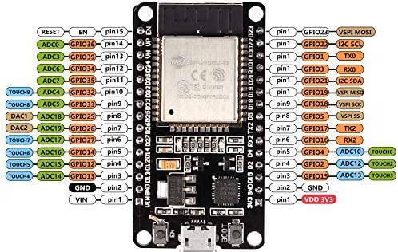
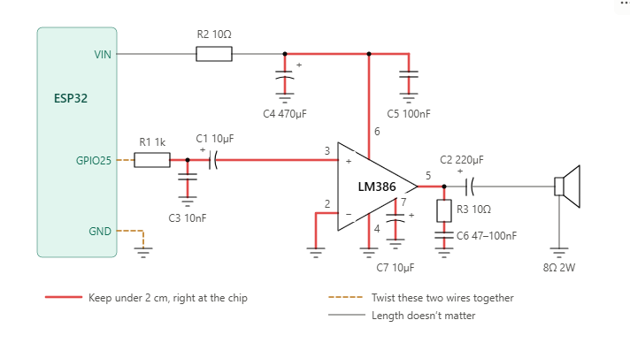
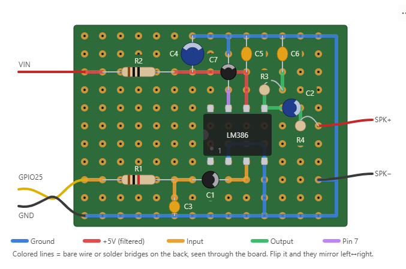
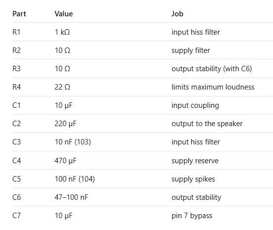

# movies — a tiny movie player on an ESP32

Plays movies from a home media library on a 2.0" 320×240 screen with sound,
using a plain ESP-WROOM-32 board. A small Python service on a Linux server does
the heavy lifting with ffmpeg; the ESP32 just shows frames and plays the audio.

```
 movie files ──> Linux server: tinyscreen.py + ffmpeg ──WiFi──> ESP32 ──> ST7789 screen
 (SMB / NFS)     JPEG frames + 8-bit audio, port 8090            └──> DAC ─> LM386 ─> speaker
```

- About 15 fps on a 320×240 screen, in sync with the sound
- Plays anything ffmpeg can read: H.264, HEVC/4K, HDR (tone-mapped to normal colors)
- Cuts off black bars baked into the video and fixes non-square pixels, so the picture fills the screen
- Pick movies from a web page; buttons for volume, skip ahead and random movie
- Movie title shown on screen while you change the volume

## Hardware

| Part | Notes |
|---|---|
| ESP-WROOM-32 dev board (30-pin) | no PSRAM needed |
| 2.0" ST7789V 240×320 SPI display | display only, no touch |
| LM386 audio amp + parts below | built on perfboard |
| 8 Ω speaker (e.g. Waveshare 2030 cavity speaker, 2 W) | |
| 3 push buttons | volume up, volume down, skip/random |

### ESP32 pinout



### Display wiring

| Display | ESP32 |
|---|---|
| VCC | 3V3 |
| GND | GND |
| SCL | GPIO 18 |
| SDA | GPIO 23 |
| CS | GPIO 5 |
| DC | GPIO 16 |
| RES | GPIO 17 |
| BL | GPIO 4 |

### Buttons

Each button goes from the GPIO to GND (the internal pull-ups are used, no resistors).

| GPIO | Button |
|---|---|
| 33 | volume up (hold to repeat) |
| 27 | volume down (hold to repeat) |
| 32 | short press: skip ahead 5 minutes · hold 1 s: play a random movie |

### Amplifier

Audio comes out of the ESP32's built-in DAC on **GPIO 25** into an LM386 amp.
The amp is powered from the ESP32's **VIN** pin (USB 5 V).







Notes:
- **R4** (22 Ω, between C2 and the speaker) limits the loudest volume. It is in
  the perfboard layout but not in the schematic. Replace it with a wire if full
  volume is not too loud.
- **C7** on pin 7 is essential. Without it the amp picks up the WiFi bursts as a
  "machine-gun" clicking.
- Keep the red (short) connections in the schematic right at the chip, and twist the
  GPIO 25 and GND wires together.
- Check ceramic cap markings: **103** = 10 nF, **104** = 100 nF, **106** = 10 µF
  (wrong for C3, C5 and C6).
- Volume is done in software, so the amp has no volume pot.

## Server setup (Linux)

Needs Python 3 (standard library only) and ffmpeg/ffprobe. For HEVC files the ffmpeg
build must include an HEVC decoder, and for HDR movies it needs the `zscale` and
`tonemap` filters. Some distro "ffmpeg-free" packages have neither; Emby's bundled
ffmpeg works.

```bash
sudo mkdir -p /opt/tinyscreen
sudo cp tinyscreen.py /opt/tinyscreen/
sudo cp tinyscreen.service /etc/systemd/system/
sudo nano /etc/systemd/system/tinyscreen.service    # set MOVIE_DIR, User=
sudo systemctl daemon-reload
sudo systemctl enable --now tinyscreen
```

Then open `http://<server>:8090/` to pick a movie.

### Settings (environment variables in the service file)

| Variable | Default | Meaning |
|---|---|---|
| `MOVIE_DIR` | `/mnt/movies` | folder searched (recursively) for movies |
| `PORT` | `8090` | HTTP port |
| `FPS` | `15` | frames per second sent to the ESP32 |
| `QUALITY` | `7` | JPEG quality, 2 (best, biggest) to 31 (worst, smallest); raise it on weak WiFi |
| `AUDIO_RATE` | `16000` | audio sample rate; `0` = no audio |
| `AUDIO_LEAD` | `0.4` | seconds of audio sent ahead of the video, as a cushion |
| `FFMPEG` | `ffmpeg` | path to ffmpeg, e.g. `/opt/emby-server/bin/ffmpeg` |
| `FFPROBE` | next to ffmpeg | path to ffprobe |
| `FFMPEG_LIBS` | — | extra library folders for ffmpeg only, e.g. `/opt/emby-server/lib:/opt/emby-server/extra/lib` for Emby's ffmpeg |

### Web endpoints

| Path | Does |
|---|---|
| `/` | movie list with filter, start-at-minute, stop |
| `/play?f=<file>&t=<minutes>` | play a movie |
| `/stop` | stop |
| `/skip?s=<seconds>` | jump ahead (negative = back) |
| `/random` | play a random movie |
| `/stream` | what the ESP32 reads (204 = nothing playing) |

The log (`journalctl -u tinyscreen`) shows each stream's start and end, its frame rate,
black-bar crop, HDR handling and any ffmpeg errors.

## Firmware (PlatformIO)

1. Open this folder in VS Code with the PlatformIO extension.
2. In `src/main.cpp`, set `WIFI_SSID`, `WIFI_PASS` and `HOST` (the server's name or IP).
3. In `platformio.ini`, set `upload_port` / `monitor_port` to your board's COM port.
4. Upload. If it stalls at `Connecting...`, hold the BOOT button. If uploads drop out
   partway through, add `upload_speed = 115200`.

On power-up the screen shows color bars for 3 seconds as a display test (yellow is the
2nd bar, red the 6th).

Display settings in `platformio.ini`: if colors look like a negative, swap
`TFT_INVERSION_ON` for `TFT_INVERSION_OFF`; if red and blue are swapped, toggle the
`TFT_RGB_ORDER=TFT_BGR` line. If you see speckles, lower `SPI_FREQUENCY` to `40000000`.

### Serial monitor

Every 5 seconds the firmware prints a status line, for example:

```
15.0 fps shown, buffered 2/3, audio 450 ms, dac 16000 Hz, sync 3 ms, fixes 0, underruns 0, dropped 0, starved 0, resyncs 0, RSSI -66
```

| Field | Good value | If not |
|---|---|---|
| fps shown | ~15 | the board can't keep up; raise `QUALITY` or lower `FPS` |
| audio | 300–600 ms | near 0 = sound is running dry |
| dac | ~16000 Hz | audio timer problem |
| sync | under ±40 ms | lip sync is being corrected |
| underruns / starved / dropped | 0 | WiFi too weak; move closer to the access point |
| RSSI | better than −70 | weak WiFi signal |

## How it works

- **Server:** for each movie, ffmpeg reads the file in real time, crops black bars,
  scales to fit 320×240 (sizes kept to multiples of 16), tone-maps HDR, and outputs
  JPEG frames plus 16 kHz 8-bit mono audio (bass cut and compressed for a small
  speaker). The two are interleaved over one HTTP connection as
  `<'V' or 'A'><uint32 length><data>` records. Video is held back so the ESP32 always
  has about 0.4 s of audio in hand.
- **ESP32, core 0:** receives the stream into three frame buffers and a 2 s audio ring.
- **ESP32, core 1:** decodes JPEGs (JPEGDEC) and draws them (TFT_eSPI, 80 MHz SPI) on a
  steady 15 fps clock.
- **Audio:** a hardware timer interrupt writes one sample to the DAC 16,000 times a
  second. The ESP32's I2S built-in-DAC mode ran 2–5× too fast, so it isn't used.
  After each frame, the sound is checked against that frame's time and paused or
  skipped if it is more than 40 ms off.
- If the WiFi drops or the board resets, it reconnects and resumes where it left off.
